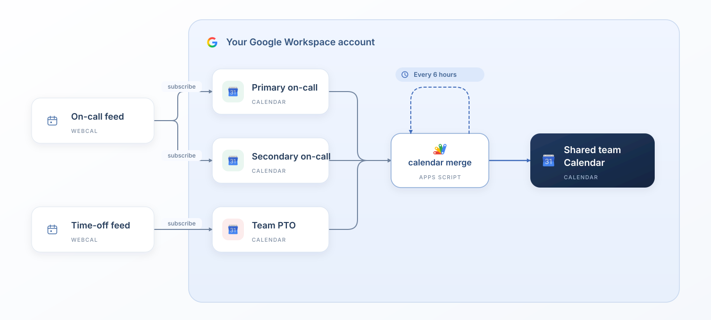

# gcal-merge

Merge multiple Google Calendars into one shared calendar with Google Apps Script. Useful for bringing team time off and on-call schedules into a single view.

Subscribe to your existing calendar feeds, choose a destination calendar, and run the script on a timer trigger.



The diagram shows an example with three sources. You can add or remove source calendars. Optional filtering of your default calendar is described below.

## What it does

- Copies events from multiple source calendars into a separate destination calendar.
- Looks ahead 90 days on each run.
- Assigns an event color for each source calendar.
- Preserves all-day and timed events, including multi-day absences.
- Matches all-day dates across calendars with different time zones.
- Removes managed destination events that no longer match a source event in the sync window.
- Leaves manual destination events alone unless they contain the script's management marker.
- Optionally includes events from the running account’s default calendar using configurable title keywords.

One-way merge: edits in the destination do not propagate back to the sources.

## Before you start

Use a Google account that can read event details on every source calendar and create, edit, and delete events on the destination calendar. If you use a managed Google Workspace account, your administrator must allow Google Apps Script and the required Calendar access.

Create a dedicated destination calendar for the merge. Do not use your main calendar or any source calendar as the destination.

## Setup

### 1. Add your source calendars

If a source comes from an external system, get its webcal/iCal subscription URL and add it to Google Calendar:

1. Open [Google Calendar](https://calendar.google.com/) in a desktop browser.
2. Next to **Other calendars**, click **+ → From URL**.
3. Paste the feed URL and add the calendar.
4. Confirm that its events appear before proceeding.

Use a subscription rather than importing an `.ics` file, so later feed changes can be picked up. Existing Google Calendars you can access can also be used directly.

### 2. Create the destination calendar

1. In Google Calendar, select **Other calendars → + → Create new calendar**.
2. Give it a name, such as **Shared team calendar**.
3. Choose its time zone and create it.

Share this calendar link with the people who should see the merged events. **See all event details** sharing permission is sufficient for viewers (they do not need to install or run the script.)

### 3. Create the Apps Script project

1. Open [Google Apps Script](https://script.google.com/) with the account that will own the automation.
2. Click **New project** and name it something like **calendar-merge**.
3. Replace the default contents of `Code.gs` with the complete contents of [cal_sync.js](cal_sync.js).
3. Collect your source and destination calendar IDs (Click calendar settings, and find the Calendar ID)
4. Replace the placeholder IDs in `getConfiguration()` at the top of the same file:

   ```javascript
   var sourceCalIds = [
     'source_cal_1@import.calendar.google.com',
     'source_cal_2@import.calendar.google.com',
     'source_cal_N@import.calendar.google.com'
   ];

   var sourceColors = [
     CalendarApp.EventColor.GREEN,
     CalendarApp.EventColor.RED,
     CalendarApp.EventColor.BLUE
   ];

   var personalCalendar = {
     enabled: false,
     color: CalendarApp.EventColor.GREEN,
     titleKeywords: ['OOO', 'VACATION']
   };
   var teamCalId = 'destination_cal@group.calendar.google.com';
   ```

All settings are grouped inside `getConfiguration()` at the top of the script. The validation and sync logic follow in the same file.

Add or remove entries as needed. `sourceColors` follows the same order as `sourceCalIds`; Colors come from Google's [EventColor palette](https://developers.google.com/apps-script/reference/calendar/event-color), such as `BLUE`, `GREEN`, `ORANGE`, and `RED`.

### 5. Validate, then run

1. Click **Save**.
2. In the function dropdown beside **Run**, select **validateConfiguration** - this is a read-only event and permissions confirmation.
3. Click **Run** and review the Calendar permissions popup requested for your account.
5. Check the execution log for **Validation passed**, it will report how many events seen on the source calendars.
6. When ready to test, tun the main **syncTeamCalendar** function, this will perform the merge. Check the execution logs for any errors.  

A successful merge ends with a summary such as `Sync complete: 3 created, 1 recolored, 2 deleted.`.

**Note: You do not need to click Deploy.** This script runs directly from the editor or a time-driven trigger. It does not require an advanced Calendar service or a separate API key.

### 6. Add the timer

If the manual run looks correct:

1. Click **Triggers** (the alarm-clock icon) in the Apps Script sidebar.
2. Click **+ Add Trigger**.
3. Choose:

   | Setting | Value |
   | --- | --- |
   | Function | `syncTeamCalendar` |
   | Deployment | `Head` |
   | Event source | `Time-driven` |
   | Type | `Hours timer` |
   | Interval | `Every 6 hours` |

4. Keep failure notifications enabled and save.
5. Confirm that only one trigger is installed for this function.

The trigger runs under the account that created it. Google schedules the executions; the six-hour interval is not a promise of exact wall-clock execution times. See Google's [installable trigger documentation](https://developers.google.com/apps-script/guides/triggers/installable).

That's it! 


# More Information

## Optional personal calendar filter

The default-calendar filter is **off by default**. Set `personalCalendar.enabled` to `true` to also copy matching events from the running account's default calendar. The example configuration matches titles containing `OOO` or `VACATION`, ignoring case.

Use it for travel, focus time, time off, or any other events identified by their titles. Configure all of the default-calendar options together inside `getConfiguration()`:

```javascript
var personalCalendar = {
  enabled: true,
  color: CalendarApp.EventColor.GREEN,
  titleKeywords: ['OOO', 'VACATION']
};
```

`titleKeywords` controls which event titles are included, not case sensitive. Replace the examples with terms you use, such as `'CONFERENCE'`, `'TRAVEL'`, or `'PTO'`. Matching entries use `personalCalendar.color` on the destination cal.

The filter is a title substring match, not an event-type or attendance check. It can match unrelated entries. Titles, descriptions, locations, and dates are copied to the destination, so enable this only if those details are appropriate for its viewers.

## How matching and cleanup work

New copies receive `Source: Webcal Sync` at the start of their descriptions. The script uses that marker to decide which destination events it may recolor or delete. Do not add it to unrelated events or remove it from copies you want the script to manage.

An event matches when its title and type agree, plus:

- **All-day events:** the same start date, independent of each calendar's time zone.
- **Timed events:** the same start timestamp.

The script creates missing copies and removes marked destination events that no longer match any source event in the current window. If a source calendar cannot be accessed, execution stops before cleanup. A readable feed that temporarily returns no events is still treated as empty and can cause its managed copies to be removed.

## Development

See [DEVELOPMENT.md](DEVELOPMENT.md) for local tests, implementation notes, and the Apps Script smoke-test workflow.
